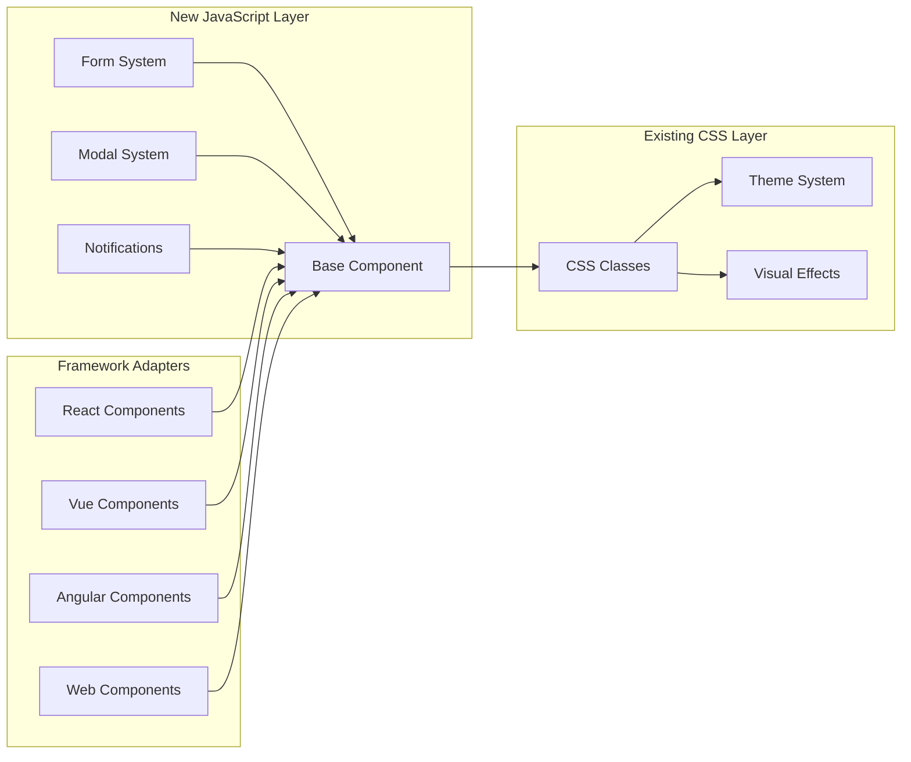

# Frost Glass CSS Brownfield Enhancement Architecture

## Introduction

This document outlines the architectural approach for enhancing Frost Glass CSS from a visual styling library into a comprehensive, accessible, production-ready component system. Its primary goal is to serve as the guiding architectural blueprint for AI-driven development of new features while ensuring seamless integration with the existing glassmorphism CSS framework.

**Relationship to Existing Architecture:**
This document supplements the existing Frost Glass CSS architecture by defining how new interactive components, JavaScript functionality, and framework integrations will integrate with the current pure CSS system. Where conflicts arise between new patterns and existing CSS-only approaches, this document provides guidance on maintaining backward compatibility while implementing the component enhancements.

### Existing Project Analysis

#### Current Project State
- **Primary Purpose:** Pure CSS glassmorphism library providing modern frosted glass effects with dual theme support
- **Current Tech Stack:** CSS3 (backdrop-filter, CSS variables), PostCSS tooling, NPM distribution
- **Architecture Style:** Theme-separated CSS architecture with namespace isolation (frostdark-* vs frostlight-*)
- **Deployment Method:** NPM package + CDN distribution (jsdelivr, unpkg)

#### Available Documentation
- README.md with installation and basic usage
- PRD document defining 4-epic enhancement roadmap
- Package.json with build scripts and dependencies
- Examples folder with HTML demonstrations
- Source code organized by core/components/themes/effects

#### Identified Constraints
- Must maintain backward compatibility with existing CSS-only implementation
- Bundle size constraints: <50KB CSS, <30KB JS (gzipped)
- No breaking changes to existing class naming conventions
- Must support progressive enhancement (CSS works without JS)
- Browser support requirements: Chrome 76+, Firefox 72+, Safari 13+

### Change Log
| Date | Version | Description | Author |
|------|---------|-------------|--------|
| 2025-09-01 | v1.0 | Initial brownfield architecture for component system enhancement | Winston (Architect) |

## Enhancement Scope and Integration Strategy

### Enhancement Overview
**Enhancement Type:** Major Feature Enhancement - Component System Evolution
**Scope:** Transform CSS-only library into full interactive component system with JavaScript APIs and framework integrations
**Integration Impact:** High - Adds JavaScript layer while preserving CSS foundation

### Integration Approach
**Code Integration Strategy:** Progressive enhancement - CSS remains functional without JavaScript, JS adds interactivity
**Database Integration:** N/A - Client-side only library
**API Integration:** New JavaScript APIs layered on existing CSS classes
**UI Integration:** Maintain existing glassmorphism aesthetic while adding interactive states

### Compatibility Requirements
- **Existing API Compatibility:** All existing CSS classes remain unchanged and functional
- **Database Schema Compatibility:** N/A - No backend components
- **UI/UX Consistency:** New components follow established frost glass visual language
- **Performance Impact:** JavaScript initialization must not block CSS rendering

## Tech Stack Alignment

### Existing Technology Stack
| Category | Current Technology | Version | Usage in Enhancement | Notes |
|----------|-------------------|---------|---------------------|--------|
| Styling | CSS3 | Modern | Foundation for all components | Backdrop-filter, CSS variables |
| Build Tool | Node.js | 18+ | Build pipeline | Existing tooling |
| CSS Processing | csso-cli | ^4.0.1 | Minification | Continue using |
| Linting | stylelint | ^15.0.0 | CSS quality | Extend for JS |
| Formatting | prettier | ^3.0.0 | Code formatting | Configure for JS/TS |
| Dev Server | live-server | ^1.2.2 | Local development | Replace with Vite |

### New Technology Additions
| Technology | Version | Purpose | Rationale | Integration Method |
|------------|---------|---------|-----------|-------------------|
| TypeScript | ^5.0 | Type safety | Developer experience, framework integration | Build step addition |
| Vite | ^5.0 | Dev server & bundling | Modern build tooling, HMR support | Replace live-server |
| Rollup | ^4.0 | Production bundling | Tree-shaking, optimization | Production builds |
| Storybook | ^7.0 | Component documentation | Interactive documentation | Separate dev tool |
| Vitest | ^1.0 | Testing framework | Fast, Vite-integrated testing | Test infrastructure |
| axe-core | ^4.8 | Accessibility testing | WCAG compliance validation | Testing integration |

## Data Models and Schema Changes

### Component State Models

#### Component Base Model
**Purpose:** Foundation for all interactive components
**Integration:** Extends existing CSS classes with JavaScript behavior

**Key Attributes:**
- `id`: string - Unique component identifier
- `theme`: 'frost_dark' | 'frost_light' - Active theme
- `state`: ComponentState - Interactive state management
- `config`: ComponentConfig - Configuration options
- `element`: HTMLElement - DOM element reference

**Relationships:**
- **With Existing:** Maps to existing CSS classes via data attributes
- **With New:** Base class for all component implementations

#### Form Component Model
**Purpose:** Manage form component states and validation
**Integration:** Enhances existing form styling with validation states

**Key Attributes:**
- `value`: any - Component value
- `validity`: ValidityState - Validation state
- `errors`: string[] - Validation messages
- `touched`: boolean - User interaction flag
- `disabled`: boolean - Disabled state

**Relationships:**
- **With Existing:** Applies validation classes to existing form styles
- **With New:** Integrates with form validation system

### Schema Integration Strategy
**Database Changes Required:**
- **New Tables:** N/A - Client-side only
- **Modified Tables:** N/A
- **New Indexes:** N/A
- **Migration Strategy:** N/A - No database

**Backward Compatibility:**
- All CSS classes remain functional without JavaScript
- Progressive enhancement ensures graceful degradation

## Component Architecture

### New Components

#### Core Component System
**Responsibility:** Base component class providing common functionality for all interactive components
**Integration Points:** DOM manipulation, event handling, state management

**Key Interfaces:**
- `initialize(element: HTMLElement, config?: ComponentConfig): void`
- `destroy(): void`
- `setState(state: Partial<ComponentState>): void`
- `getState(): ComponentState`

**Dependencies:**
- **Existing Components:** CSS class application via classList API
- **New Components:** Base class for all interactive components

**Technology Stack:** TypeScript, ES2020+ modules

#### Form System
**Responsibility:** Complete form component suite with validation and state management
**Integration Points:** Native form APIs, HTML5 validation, ARIA attributes

**Key Interfaces:**
- `FormField.validate(): ValidationResult`
- `FormField.setValue(value: any): void`
- `Form.submit(): Promise<void>`
- `Form.reset(): void`

**Dependencies:**
- **Existing Components:** Form CSS classes for styling
- **New Components:** Validation system, error display

**Technology Stack:** TypeScript, native FormData API

#### Modal System
**Responsibility:** Accessible modal dialogs with focus management
**Integration Points:** Focus trap, scroll lock, ARIA live regions

**Key Interfaces:**
- `Modal.open(): void`
- `Modal.close(): void`
- `Modal.onClose(callback: Function): void`

**Dependencies:**
- **Existing Components:** Glassmorphism backdrop styles
- **New Components:** Focus trap utility, scroll lock

**Technology Stack:** TypeScript, focus-trap library

#### Notification System
**Responsibility:** Toast notifications with queue management
**Integration Points:** ARIA live regions, animation system

**Key Interfaces:**
- `notify(message: string, options?: NotifyOptions): Notification`
- `Notification.dismiss(): void`
- `NotificationQueue.clear(): void`

**Dependencies:**
- **Existing Components:** Animation CSS classes
- **New Components:** Queue manager, positioning system

**Technology Stack:** TypeScript, CSS animations

### Component Interaction Diagram


## API Design and Integration

### API Integration Strategy
**API Integration Strategy:** Component JavaScript APIs layered on CSS foundation
**Authentication:** N/A - Client-side library
**Versioning:** Semantic versioning with backward compatibility

### Component Initialization API
- **Method:** JavaScript
- **Purpose:** Initialize components with configuration
- **Integration:** Progressive enhancement of HTML elements

**Request:**
```javascript
FrostGlass.init({
  theme: 'auto', // 'frost_dark' | 'frost_light' | 'auto'
  components: {
    forms: true,
    modals: true,
    notifications: true
  },
  accessibility: {
    announceChanges: true,
    keyboardNavigation: true
  }
});
```

**Response:**
```javascript
{
  initialized: true,
  components: ['forms', 'modals', 'notifications'],
  theme: 'frost_dark'
}
```

### Form Validation API
- **Method:** JavaScript
- **Purpose:** Programmatic form validation
- **Integration:** HTML5 validation API enhancement

**Request:**
```javascript
const form = FrostGlass.Form('#contact-form');
form.validate({
  rules: {
    email: ['required', 'email'],
    message: ['required', 'minLength:10']
  }
});
```

**Response:**
```javascript
{
  valid: false,
  errors: {
    email: ['Email is required'],
    message: ['Message must be at least 10 characters']
  }
}
```

## Source Tree Integration

### Existing Project Structure
```plaintext
frost-glass-css/
├── src/
│   ├── core/
│   │   ├── variables.css
│   │   ├── base.css
│   │   └── utilities.css
│   ├── components/
│   ├── themes/
│   └── effects/
├── dist/
├── examples/
└── package.json
```

### New File Organization
```plaintext
frost-glass-css/
├── src/
│   ├── core/                    # Existing CSS core
│   ├── components/               # Existing CSS components
│   ├── js/                      # New JavaScript layer
│   │   ├── core/                # Core JS functionality
│   │   │   ├── Component.ts
│   │   │   ├── State.ts
│   │   │   └── Events.ts
│   │   ├── components/          # JS component implementations
│   │   │   ├── Form.ts
│   │   │   ├── Modal.ts
│   │   │   ├── Notification.ts
│   │   │   └── index.ts
│   │   ├── utils/               # Utility functions
│   │   │   ├── focus-trap.ts
│   │   │   ├── validation.ts
│   │   │   └── accessibility.ts
│   │   └── index.ts             # Main entry point
│   ├── frameworks/              # Framework integrations
│   │   ├── react/
│   │   ├── vue/
│   │   ├── angular/
│   │   └── web-components/
│   └── types/                   # TypeScript definitions
│       └── index.d.ts
├── tests/                       # New test suite
│   ├── unit/
│   ├── integration/
│   └── accessibility/
└── .storybook/                  # Storybook configuration
```

### Integration Guidelines
- **File Naming:** kebab-case for files, PascalCase for classes
- **Folder Organization:** Separate JS from CSS, maintain existing CSS structure
- **Import/Export Patterns:** ES modules with named exports, barrel exports for components

## Infrastructure and Deployment Integration

### Existing Infrastructure
**Current Deployment:** NPM publish + CDN auto-update
**Infrastructure Tools:** GitHub Actions, NPM registry
**Environments:** Local development, NPM production

### Enhancement Deployment Strategy
**Deployment Approach:** Gradual rollout with feature flags
**Infrastructure Changes:** Add Storybook hosting, expand CI/CD pipeline
**Pipeline Integration:** Add JS build, test, and bundling steps

### Rollback Strategy
**Rollback Method:** NPM version revert, CDN pinning
**Risk Mitigation:** Comprehensive testing, staged releases
**Monitoring:** Bundle size monitoring, error tracking

## Coding Standards and Conventions

### Existing Standards Compliance
**Code Style:** Prettier formatting, consistent indentation
**Linting Rules:** Stylelint for CSS, add ESLint for JS/TS
**Testing Patterns:** Currently none, adding Vitest
**Documentation Style:** JSDoc comments, README updates

### Enhancement-Specific Standards
- **TypeScript Strict Mode:** Enable strict type checking for reliability
- **Accessibility First:** Every component must pass axe-core tests
- **Progressive Enhancement:** CSS must work without JavaScript
- **Bundle Size Limits:** Enforce via bundlesize in CI

### Critical Integration Rules
- **Existing API Compatibility:** No changes to existing CSS class names
- **Database Integration:** N/A - Client-side only
- **Error Handling:** Graceful degradation when JS fails
- **Logging Consistency:** Console warnings in dev only

## Testing Strategy

### Integration with Existing Tests
**Existing Test Framework:** None currently
**Test Organization:** New tests/ directory structure
**Coverage Requirements:** 90% minimum for new JS code

### New Testing Requirements

#### Unit Tests for New Components
- **Framework:** Vitest with @testing-library
- **Location:** tests/unit/components/
- **Coverage Target:** 90% statements, branches, functions
- **Integration with Existing:** Test CSS class application

#### Integration Tests
- **Scope:** Component interactions, form flows, modal stacking
- **Existing System Verification:** CSS classes remain functional
- **New Feature Testing:** JavaScript enhancement validation

#### Regression Testing
- **Existing Feature Verification:** Visual regression with Percy
- **Automated Regression Suite:** GitHub Actions on PR
- **Manual Testing Requirements:** Accessibility testing with screen readers

## Security Integration

### Existing Security Measures
**Authentication:** N/A - Client-side library
**Authorization:** N/A
**Data Protection:** No data storage
**Security Tools:** npm audit, Dependabot

### Enhancement Security Requirements
**New Security Measures:** XSS protection in component rendering
**Integration Points:** Sanitize user input in forms
**Compliance Requirements:** OWASP client-side security guidelines

### Security Testing
**Existing Security Tests:** npm audit only
**New Security Test Requirements:** XSS vulnerability scanning
**Penetration Testing:** Not required for client library

## Checklist Results Report

### Overall Assessment: READY FOR IMPLEMENTATION
- **Integration Complexity:** Medium - Adding JS layer to CSS foundation
- **Risk Level:** Low - Progressive enhancement ensures backward compatibility
- **Key Success Factor:** Maintaining CSS-only functionality

### Critical Implementation Sequence:
1. **Set up TypeScript and Vite build pipeline**
2. **Implement base component system**
3. **Add accessibility testing infrastructure**
4. **Build form components (Epic 1)**
5. **Create Storybook documentation**

### Integration Validation Points:
- CSS classes work without JavaScript ✓
- Bundle sizes within limits ✓
- Accessibility standards met ✓
- Framework adapters properly isolated ✓

## Next Steps

### Story Manager Handoff
"Review the Frost Glass CSS brownfield architecture document which transforms the existing CSS-only library into a comprehensive component system. The architecture maintains complete backward compatibility with existing CSS classes while adding a JavaScript layer for interactivity. Begin with Epic 1 focusing on the accessibility foundation and core form components. Key integration requirement: all CSS must remain functional without JavaScript. Start with implementing the base component system that will underpin all interactive components."

### Developer Handoff
"Begin implementation of the Frost Glass CSS component system enhancement following the brownfield architecture. The existing CSS classes in src/core and src/components must remain unchanged. Set up the new TypeScript build pipeline with Vite first, then implement the base Component class in src/js/core/Component.ts. All new JavaScript must use progressive enhancement - test that CSS styling works when JavaScript is disabled. Follow the existing CSS naming conventions (frostdark-* and frostlight-*) when adding state classes. Run 'npm run build' to ensure the existing CSS build still works after your changes."